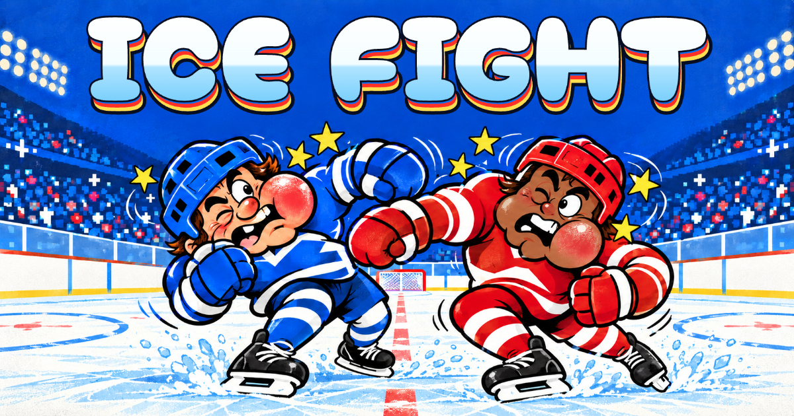
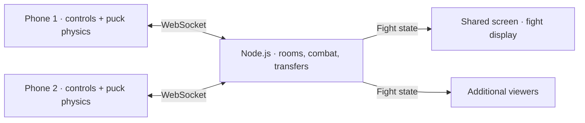

<p align="center">
  
</p>

# Ice Fight

**Two phones. One fight. The buttons won't stay put.**

A browser fighting game where your controller is an ice rink. Movement, punches, and kicks are pucks that slide, collide, and can be flung onto your opponent's phone. Every puck you send across becomes one of their controls.

[**Play Ice Fight**](https://icefight.fly.dev) · [Run locally](#run-locally) · [How it works](#how-it-works) · [Development notes](docs/development-history.md)

Experimental prototype built with JavaScript, Canvas 2D, Node.js, and WebSockets. The hosted demo may run an earlier revision than this repository.

## Bring two phones and a screen

Use two phones in landscape as controllers and a separate browser screen to watch the fighters. A laptop, desktop, or TV with a browser works as the fight display. No app installation or account required.

1. Open [Ice Fight](https://icefight.fly.dev) on the first phone, **create a rink**, and claim **Player 1**.
2. Share the room link, code, or QR with the second phone and claim **Player 2**.
3. Open the same room on the viewing screen and choose **Watch the fight**.
4. Arrange your pucks while waiting. The fight starts when both controllers connect.

The phones show the controls; the separate screen shows the fight. Additional viewers can open the same room. A display can join late and does not control the match.

## Your controls are in play

Each player starts with ten pucks: four directions, three punches, and three kicks.

| Puck | Action |
| --- | --- |
| Left / right arrow | Hold to move |
| Up arrow | Tap to jump |
| Down arrow | Hold to crouch |
| Hexagon with 1 / 2 / 3 dots | Light / medium / heavy punch |
| Square with 1 / 2 / 3 dots | Light / medium / heavy kick |

- **Press to act.** Jump and attacks trigger on touchdown. Directional holds continue even as the puck moves away from your finger.
- **Grab, drag, and fling.** Grab near a puck's center to position it; release while moving to fling it. A gentle tap nudges it, while an edge touch shoves it harder.
- **Send controls across the ice.** Push a puck through the top seam to give it to your opponent. Its original color stays the same; the phone holding it determines who can use it.
- **Win the round.** Fight to a KO or the end of the five-minute clock. Either player can request a rematch afterward.

If a controller disconnects, the round pauses. Return using the original browser to reclaim your slot. Keep your personal controller link private; share the room invitation instead. Lost controller credentials require a new rink.

## Run locally

Requires **Node.js 22+** and npm.

```sh
git clone https://github.com/canted/ice-fight.git
cd ice-fight
npm ci
npm start
```

Open [localhost:3000](http://localhost:3000) on your computer. On phones connected to the same Wi-Fi, open your computer's LAN address, for example `http://192.168.1.20:3000`. Use that address when creating the room so invitations point to a host the phones can reach.

`localhost` on a phone points to the phone itself. If the LAN address does not load, check the computer's firewall and whether the Wi-Fi isolates devices from each other.

| Command | Purpose |
| --- | --- |
| `npm start` | Start the HTTP and WebSocket server |
| `npm run dev` | Restart the server when source files change |
| `npm test` | Run the automated game and protocol tests |
| `npm run check` | Check the TypeScript wire contract and project configuration |
| `npm run build` | Run the same check; no bundle is generated |

The application is JavaScript with a checked TypeScript protocol definition, rather than a fully type-checked TypeScript application.

## How it works

Each phone simulates the pucks it owns at 120 Hz. The server resolves combat at 60 Hz, validates inputs, and coordinates puck ownership as controls cross the seam. Displays receive state over WebSockets and render the fight independently.



There is no frontend framework, bundling step, or database. Rooms live in memory in one server process; restarting it ends existing rooms. Controller-owned physics keeps local dragging responsive, while ownership epochs prevent stale input from controlling transferred pucks. This is an experimental trust model, not a competitive anti-cheat system.

| File | Responsibility |
| --- | --- |
| [`server.mjs`](server.mjs) | HTTP routes, rooms, player claims, WebSockets, and connection limits |
| [`game.mjs`](game.mjs) | Fighters, attacks, rounds, and ownership validation |
| [`public/owner-rink.js`](public/owner-rink.js) | Controller-owned puck simulation |
| [`public/puck-motion.js`](public/puck-motion.js) | Shared motion, fling sampling, and settling |
| [`public/app.js`](public/app.js) | Controller input and canvas rendering |
| [`public/lobby.js`](public/lobby.js) | Room creation, invitations, and joining |
| [`protocol.ts`](protocol.ts) | Wire contract |
| [`sandbox/doughboy/`](sandbox/doughboy/README.md) | Separate experimental fighter-physics playground |

For the design and measured behavior, see [controller ownership](docs/owner-motion.md), [input timing](docs/controller-timing.md), and [responsiveness](docs/responsiveness.md). Earlier revisions are preserved in the [development history](docs/development-history.md).

## Test and playtest

```sh
npm test
npm run build
```

For browser coverage, install Google Chrome, leave the local server running, and run:

```sh
TEST_URL=http://localhost:3000 node tests/owner-trajectories-browser.mjs
TEST_URL=http://localhost:3000 node tests/owner-lifecycle-browser.mjs
TEST_URL=http://localhost:3000 node tests/timeline-network.mjs
```

Browser suites use Playwright and write local evidence to `test-results/`, which is excluded from Git. Coverage includes transfers, stale ownership, holds and cancellation, collisions, combat, reconnects, and multiple displays.

Physical iPhone Safari, real multitouch hardware, and public cross-network load still need playtesting. Automated phone-sized browser runs do not establish physical-device compatibility.

## Host your own rink

Use a host that supports a long-running Node.js process and WebSockets. A static-only host such as GitHub Pages cannot run the game server.

| Variable | Default | Purpose |
| --- | --- | --- |
| `PORT` | `3000` | HTTP and WebSocket port |
| `PUBLIC_URL` | `http://localhost:<PORT>` | Public origin used in links and social metadata |

A Dockerfile is included:

```sh
docker build -t ice-fight .
docker run --rm -p 3000:8080 -e PUBLIC_URL=http://localhost:3000 ice-fight
```

Set `PUBLIC_URL` to your reachable HTTPS origin for an internet deployment. The health endpoint is `/health`.

[`fly.toml`](fly.toml) describes the existing demo. To deploy a separate copy on Fly.io, choose your own app name and update both `app` and `PUBLIC_URL`. Keep **one server instance**: rooms are not shared across processes. Current limits allow two controllers and up to 32 viewers per room. Rate and admission limits constrain traffic, but do not enforce a hosting spend cap.

## Contributing

Useful playtest reports include the devices and browsers, whether players shared Wi-Fi, steps to reproduce, and expected versus actual behavior. Avoid posting personal controller URLs.

For code changes, run `npm test` and `npm run build`. Changes to input, motion, or ownership should also exercise the browser suites and a two-phone session when hardware is available.

## Credits and licensing

The banner includes AI-assisted artwork; see [art notes](art/EDIT-NOTES.md). Cherry Bomb One by Satsuyako is bundled under the [SIL Open Font License](public/fonts/CherryBombOne-OFL.txt).

No project-wide license has been selected yet. Third-party components retain their own licenses.

The README structure draws on [AirConsole Pong](https://github.com/AirConsole/games-pong) for the device architecture, [HappyFunTimes](https://github.com/greggman/HappyFunTimes) for the player/developer split, and [mk.js](https://github.com/mgechev/mk.js) for concise browser-fighter setup. These are documentation references, not dependencies; HappyFunTimes is deprecated.
